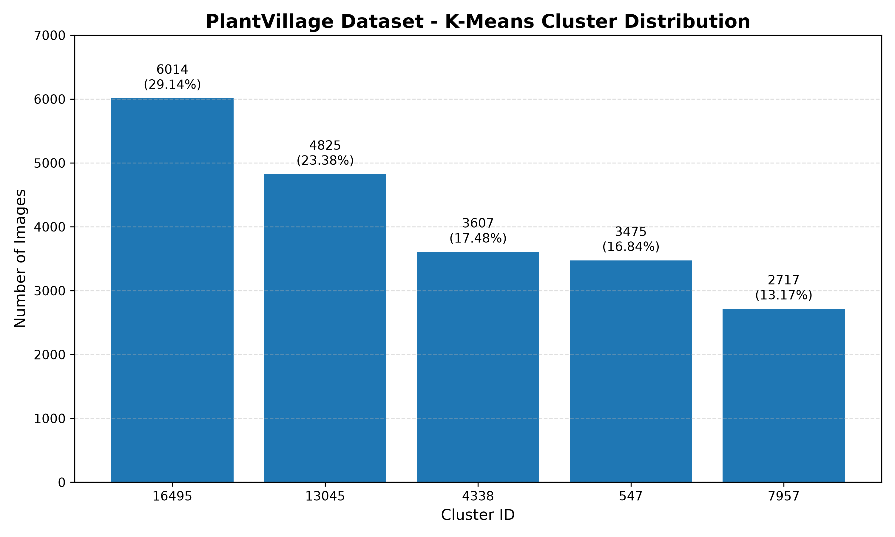
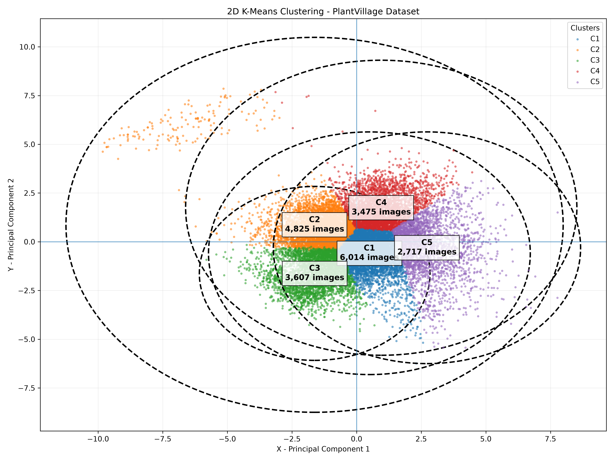
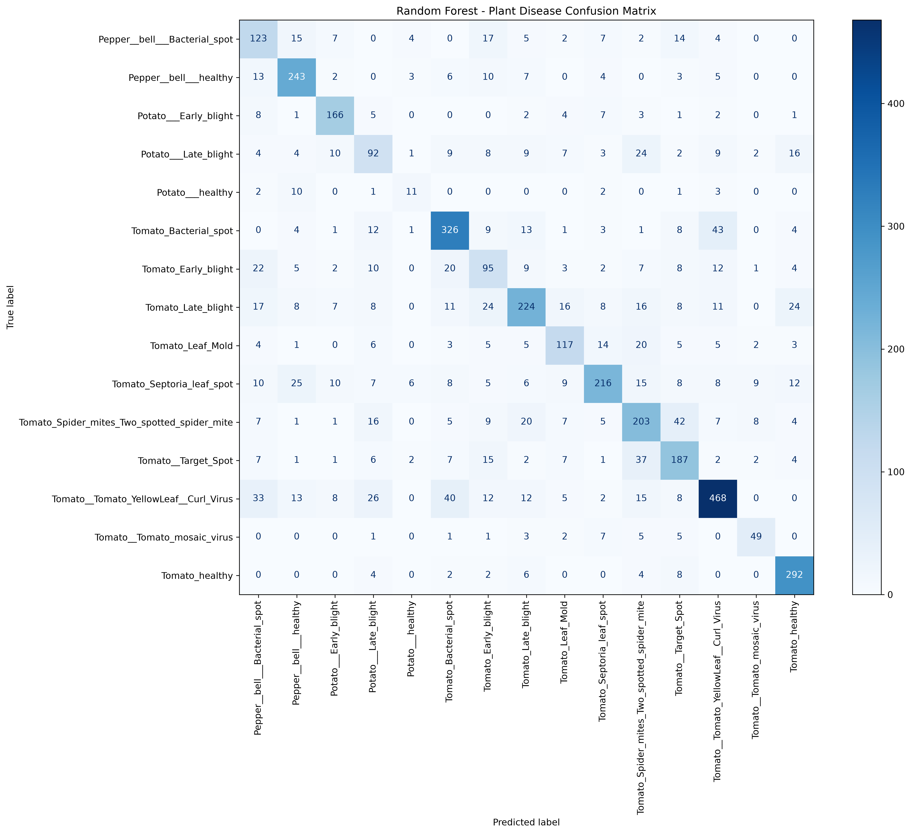

# Smart Agriculture: Plant Disease Analysis Using Big Data and Machine Learning

## 1. Project Overview

Smart Agriculture is a data-driven agricultural analysis project that uses Big Data technologies, machine learning, and image processing to analyze plant leaf images and identify patterns associated with plant diseases.

The project uses the PlantVillage dataset containing images of healthy and diseased plant leaves. Hadoop and MapReduce are used for distributed dataset analysis, Apache Hive is used for structured metadata analysis, Apache Mahout is used for unsupervised clustering, and Random Forest is used for supervised plant disease classification.

The project combines these technologies to demonstrate how large-scale agricultural image datasets can be processed, analyzed, clustered, and classified.

## 2. Project Objectives

- Analyze a large collection of plant leaf images.
- Identify healthy and diseased plant categories.
- Perform distributed data processing using Hadoop MapReduce.
- Store and analyze image metadata using Apache Hive.
- Group similar plant images using K-Means clustering.
- Classify plant diseases using Random Forest.
- Evaluate machine learning models using appropriate performance metrics.
- Visualize clustering and classification results.

## 3. Technologies Used

| Technology | Purpose |
|---|---|
| Python | Data processing and machine learning |
| Hadoop 3.5.0 | Distributed data processing |
| HDFS | Distributed dataset storage |
| Hadoop MapReduce | Category and health-status analysis |
| Apache Hive 4.1.0 | Metadata storage and querying |
| Apache Mahout 0.13.0 | K-Means clustering |
| Scikit-learn | PCA, Random Forest and evaluation |
| Pandas | Dataset manipulation |
| NumPy | Numerical operations |
| Matplotlib | Result visualization |
| Java 17 | Hadoop and Mahout execution |
| Git and GitHub | Version control and project hosting |

## 4. Dataset Description

**Dataset:** PlantVillage Dataset

The dataset contains images of plant leaves belonging to 15 categories.

### Dataset distribution

| Dataset Split | Number of Images |
|---|---:|
| Training | 14,437 |
| Validation | 2,073 |
| Testing | 4,128 |
| **Total** | **20,638** |

### Plant categories

1. Pepper Bell Bacterial Spot
2. Pepper Bell Healthy
3. Potato Early Blight
4. Potato Late Blight
5. Potato Healthy
6. Tomato Bacterial Spot
7. Tomato Early Blight
8. Tomato Late Blight
9. Tomato Leaf Mold
10. Tomato Septoria Leaf Spot
11. Tomato Spider Mites
12. Tomato Target Spot
13. Tomato Yellow Leaf Curl Virus
14. Tomato Mosaic Virus
15. Tomato Healthy

### Dataset health status

| Health Status | Image Count | Percentage |
|---|---:|---:|
| Diseased | 17,417 | 84.39% |
| Healthy | 3,221 | 15.61% |
| **Total** | **20,638** | **100%** |

## 5. Project Workflow

The project is implemented through the following stages:

1. Dataset collection and organization.
2. Uploading the dataset to Hadoop Distributed File System.
3. Distributed analysis using Hadoop MapReduce.
4. Metadata generation and analysis using Apache Hive.
5. Image feature extraction and preprocessing.
6. Feature standardization using Z-score normalization.
7. SequenceFile generation for Mahout.
8. K-Means clustering using Apache Mahout.
9. Cluster evaluation and visualization.
10. Supervised classification using Random Forest.
11. Model evaluation and result visualization.

## 6. Hadoop MapReduce Analysis

Hadoop MapReduce was implemented to analyze the PlantVillage dataset.

### Mapper

The mapper extracts the plant disease category from each image path and generates two types of records:

- Category-wise image count.
- Healthy and diseased image count.

### Reducer

The reducer aggregates the intermediate results and calculates the total number of images in each category.

### MapReduce Results

| Category | Image Count |
|---|---:|
| Pepper Bell Bacterial Spot | 997 |
| Pepper Bell Healthy | 1,478 |
| Potato Early Blight | 1,000 |
| Potato Late Blight | 1,000 |
| Potato Healthy | 152 |
| Tomato Bacterial Spot | 2,127 |
| Tomato Early Blight | 1,000 |
| Tomato Late Blight | 1,909 |
| Tomato Leaf Mold | 952 |
| Tomato Septoria Leaf Spot | 1,771 |
| Tomato Spider Mites | 1,676 |
| Tomato Target Spot | 1,404 |
| Tomato Yellow Leaf Curl Virus | 3,208 |
| Tomato Mosaic Virus | 373 |
| Tomato Healthy | 1,591 |
| **Total** | **20,638** |

**Output:** `mapreduce_output/part-00000` (stored in HDFS).

## 7. Apache Hive Metadata Analysis

Apache Hive was used to create an external table named `plantvillage_metadata`.

The table contains:

- Image path
- Dataset split
- Disease category
- Health status

### Hive Operations Performed

- Created the `smart_agriculture` database.
- Created an external metadata table.
- Loaded image metadata from HDFS.
- Calculated the total number of records.
- Performed category-wise image counting.
- Analyzed healthy and diseased image distribution.
- Analyzed train, validation, and test dataset distribution.

### Hive Results

| Analysis | Result |
|---|---:|
| Total Images | 20,638 |
| Diseased Images | 17,417 |
| Healthy Images | 3,221 |
| Training Images | 14,437 |
| Validation Images | 2,073 |
| Testing Images | 4,128 |

## 8. Feature Extraction and Preprocessing

Image processing was performed using Python.

Each image was resized to **64 × 64 pixels** and converted into RGB format.

Six numerical features were extracted:

| Feature | Description |
|---|---|
| Mean_R | Average red channel intensity |
| Mean_G | Average green channel intensity |
| Mean_B | Average blue channel intensity |
| Std_R | Red channel standard deviation |
| Std_G | Green channel standard deviation |
| Std_B | Blue channel standard deviation |

### Feature Standardization

Z-score standardization was applied to the six numerical features.

The standardization formula is:

`Z = (X - Mean) / Standard Deviation`

### Generated Files

- `plant_features.csv`
- `plant_vectors_current.tsv`
- `plant_mapping_current.csv`

A total of 20,638 images were successfully represented in the feature dataset. One non-image file was skipped during image processing.

## 9. K-Means Clustering Using Apache Mahout

Apache Mahout was used to perform unsupervised clustering on the standardized image features.

### Implementation Details

| Parameter | Value |
|---|---|
| Algorithm | K-Means |
| Framework | Apache Mahout |
| Number of Clusters (K) | 5 |
| Distance Measure | Euclidean Distance |
| Maximum Iterations | 10 |
| Convergence Threshold | 0.5 |
| Random Seed | 42 |
| Input Records | 20,638 |

The six extracted RGB statistical features were converted into Mahout-compatible SequenceFile format.

### Cluster Distribution

| Cluster | Cluster ID | Image Count | Percentage |
|---|---:|---:|---:|
| C1 | 16495 | 6,014 | 29.14% |
| C2 | 13045 | 4,825 | 23.38% |
| C3 | 4338 | 3,607 | 17.48% |
| C4 | 547 | 3,475 | 16.84% |
| C5 | 7957 | 2,717 | 13.16% |
| **Total** | | **20,638** | **100%** |

### K-Means Evaluation

| Metric | Result |
|---|---:|
| Silhouette Score | 0.2465 |
| Adjusted Rand Index (ARI) | 0.0889 |
| Normalized Mutual Information (NMI) | 0.1684 |
| Homogeneity | 0.1358 |
| Completeness | 0.2217 |
| V-Measure | 0.1684 |
| Cluster Mapping Accuracy | 21.65% |

**Note:** The Silhouette Score was calculated using a reproducible sample of 5,000 images. ARI, NMI, Homogeneity, Completeness, and V-Measure were calculated using all 20,638 images.

K-Means is an unsupervised algorithm, so conventional classification accuracy is not directly applicable. The 21.65% value represents external cluster accuracy calculated using cluster-to-class matching.

The clusters represent visual similarity based on the six RGB statistical features. They do not directly represent confirmed disease categories.

### K-Means Visualizations

#### 1. Cluster Distribution Graph



#### 2. Circular Cluster Distribution

The circular visualization represents the relative size of each of the five clusters.



#### 3. Two-Dimensional K-Means Cluster Visualization

The PCA-based visualization projects the six-dimensional feature data into two dimensions. Each point represents an image, and each group represents one K-Means cluster.


**Generated PDF reports:**

- `kmeans_cluster_distribution.pdf`
- `kmeans_cluster_circles.pdf`

## 10. Random Forest Classification

Random Forest was implemented as a supervised machine learning algorithm to classify plant diseases.

### Model Configuration

| Parameter | Value |
|---|---|
| Algorithm | Random Forest Classifier |
| Number of Trees | 300 |
| Feature Selection | Square Root |
| Class Weight | Balanced |
| Random State | 42 |
| Input Features | 6 |
| Output Classes | 15 |

### Dataset Split

| Split | Images |
|---|---:|
| Training | 14,437 |
| Validation | 2,073 |
| Testing | 4,128 |

The model was initially trained using the training dataset and evaluated on the validation dataset. It was then retrained using the combined training and validation datasets and evaluated on the independent test dataset.

### Random Forest Results

| Evaluation Metric | Score |
|---|---:|
| Validation Accuracy | 68.02% |
| Test Accuracy | 68.12% |
| Macro Precision | 64.24% |
| Macro Recall | 64.84% |
| Macro F1-Score | 64.32% |
| Weighted Precision | 68.59% |
| Weighted Recall | 68.12% |
| Weighted F1-Score | 68.10% |

### Random Forest Visualizations

#### 1. Confusion Matrix

The confusion matrix displays the actual and predicted disease categories and helps identify correct and incorrect classifications.



#### 2. Random Forest Decision Tree

The following visualization displays one representative decision tree from the 300-tree Random Forest model, limited to the first three levels for readability.


**Generated model and result files:**

- `random_forest_model.pkl`
- `random_forest_metrics.csv`
- `random_forest_classification_report.csv`
- `random_forest_predictions.csv`
- `random_forest_confusion_matrix.png`

## 11. Algorithm Comparison

| Evaluation | K-Means | Random Forest |
|---|---:|---:|
| Learning Type | Unsupervised | Supervised |
| Number of Groups / Classes | 5 clusters | 15 classes |
| Evaluation Metric | Silhouette Score | Test Accuracy |
| Main Result | 0.2465 | 68.12% |
| Primary Purpose | Image grouping | Disease classification |

Random Forest is currently the classification model used for predicting plant disease categories. K-Means provides an additional unsupervised approach for discovering visual similarities among plant images.

Their accuracy-related results should not be directly compared because the algorithms have different objectives and learning methods.

## 12. Project Folder Structure

```text
smart_agriculture/
│
├── mapreduce/
│   ├── mapper.py
│   └── reducer.py
│
├── metadata/
│   └── plantvillage_metadata.tsv
│
├── VectorSequenceConverter.java
│
├── extract_features.py
├── standardize_features.py
├── evaluate_kmeans.py
├── kmeans_accuracy.py
├── random_forest.py
│
├── plant_features.csv
├── plant_labels.csv
├── plant_mapping_current.csv
├── plant_vectors.tsv
├── plant_vectors_current.tsv
│
├── final_cluster_disease_report.csv
├── kmeans_evaluation_metrics.csv
├── random_forest_metrics.csv
├── random_forest_classification_report.csv
├── random_forest_predictions.csv
│
├── kmeans_cluster_distribution.png
├── kmeans_cluster_distribution.pdf
├── kmeans_cluster_circles.png
├── kmeans_cluster_circles.pdf
│
├── random_forest_confusion_matrix.png
├── random_forest_classification_tree.png
│
├── README.md
└── .gitignore
```

Additional intermediate Hadoop, Hive, and Mahout outputs are stored in HDFS or excluded from Git where appropriate.

## 13. Installation and Execution

### Prerequisites

- Ubuntu Linux
- Java 17
- Hadoop 3.5.0
- Apache Hive 4.1.0
- Apache Mahout 0.13.0
- Python 3
- Git

### Python Environment

Create and activate a virtual environment:

```bash
python3 -m venv venv
source venv/bin/activate
```

Install Python dependencies:

```bash
pip install pandas numpy matplotlib scikit-learn joblib pillow
```

### Feature Extraction

```bash
python extract_features.py
```

### Feature Standardization

```bash
python standardize_features.py
```

### K-Means Evaluation

```bash
python evaluate_kmeans.py
python kmeans_accuracy.py
```

### K-Means Visualizations

```bash
python plot_kmeans_cluster_circles.py
```

The distribution chart can also be regenerated using the corresponding plotting script if available.

### Random Forest Classification

```bash
python random_forest.py
```

### Random Forest Tree Visualization

```bash
python visualize_random_forest.py
```

**Important:** Hadoop, Hive, and Mahout jobs require their respective services and input data to be configured and available in HDFS. The Python commands above assume the required local CSV and TSV files have already been generated.

## 14. Conclusion

This project demonstrates the application of Big Data processing and machine learning techniques to agricultural image analysis.

Hadoop MapReduce successfully processed 20,638 plant images and generated category-wise and health-status statistics. Apache Hive provided structured metadata analysis. Apache Mahout grouped the image feature vectors into five clusters using K-Means. Random Forest achieved a test accuracy of 68.12% using six RGB statistical features.

The results demonstrate how distributed processing, unsupervised learning, and supervised classification can be combined to analyze agricultural datasets.

The current Random Forest model provides a baseline for plant disease classification. Further improvements can be explored using richer image features and deep learning approaches such as Convolutional Neural Networks (CNNs).

## 15. Future Enhancements

- Implement CNN-based plant disease classification.
- Improve feature extraction using image texture and shape information.
- Compare additional machine learning algorithms.
- Integrate real-time sensor data.
- Develop a farmer-friendly dashboard.
- Integrate weather information for agricultural recommendations.
- Explore multilingual voice-based interaction.
- Extend the system toward real-time plant disease monitoring.

## 16. Repository

**GitHub Repository:**  
https://github.com/Pranathi161205/smart_agriculture

---

**Project:** Smart Agriculture  
**Domain:** Big Data Analytics, Machine Learning, and Agricultural Image Analysis  
**Dataset:** PlantVillage  
**Total Images Analyzed:** 20,638
